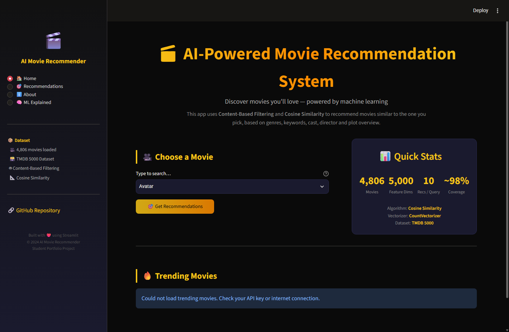
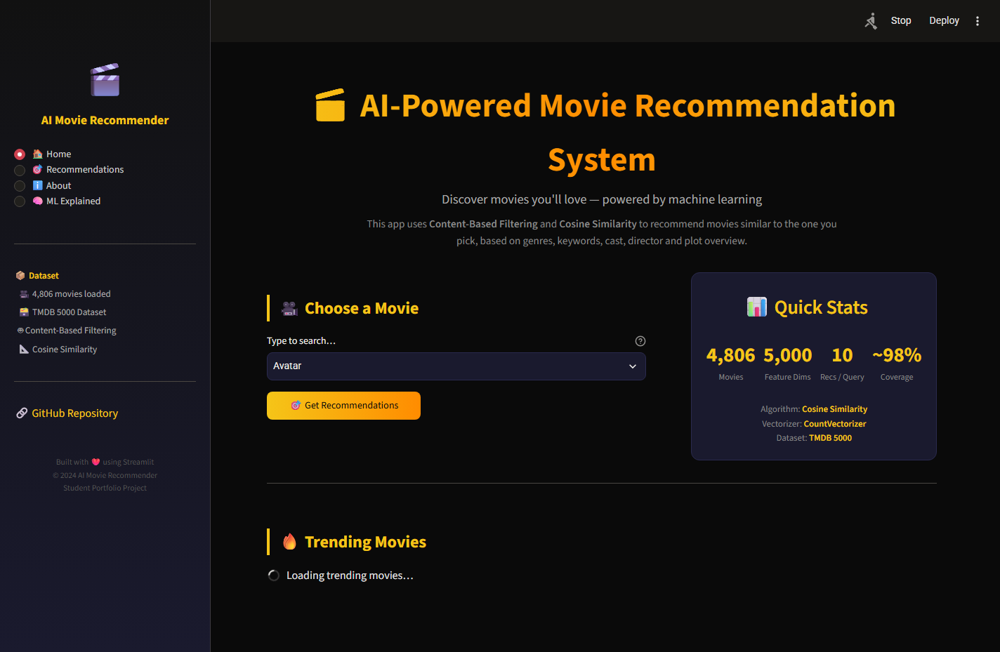

# 🎬 AI-Powered Movie Recommendation System

[](https://www.python.org/downloads/)
[](https://streamlit.io/)
[](https://scikit-learn.org/)
[](LICENSE)
[](https://www.kaggle.com/datasets/tmdb/tmdb-movie-metadata)
[](https://pandas.pydata.org/)

---

## 📋 Table of Contents

- [🎯 Project Overview](#-project-overview)
- [✨ Features](#-features)
- [🧠 Machine Learning Approach](#-machine-learning-approach)
- [🏗️ Project Architecture](#️-project-architecture)
- [📁 Project Structure](#-project-structure)
- [🛠️ Technology Stack](#️-technology-stack)
- [📊 Dataset](#-dataset)
- [🚀 Installation & Setup](#-installation--setup)
- [🔑 TMDB API Key Setup](#-tmdb-api-key-setup)
- [📸 Screenshots](#-screenshots)
- [🔬 How It Works — Step by Step](#-how-it-works--step-by-step)
- [⚡ Performance](#-performance)
- [🧪 Testing](#-testing)
- [🚀 Future Enhancements](#-future-enhancements)
- [📝 Resume Description](#-resume-description)
- [🎯 Interview Q&A](#-interview-qa)
- [👨‍💻 Author](#-author)
- [📄 License](#-license)

---

## 🎯 Project Overview

This project is a **content-based movie recommendation system** built entirely in Python. Given any movie title from the TMDB 5000 dataset, the system analyzes its genres, keywords, cast, director, and plot overview, then surfaces the ten most similar movies a viewer is likely to enjoy. The finished product is wrapped in an interactive **Streamlit** web application that fetches live movie posters and metadata from the TMDB REST API, giving the project a production-quality feel that is immediately accessible in a browser with a single command.

Recommendation engines are among the most commercially impactful applications of machine learning — they drive content discovery at Netflix, Spotify, YouTube, and Amazon. Building one from scratch demonstrates end-to-end ML engineering: data acquisition, exploratory analysis, feature engineering, model training, serialization, and UI delivery. For a portfolio, this project communicates that you can take a fuzzy business problem ("help users discover content they will love") all the way to a live, shareable demo — a signal hiring managers value highly.

The underlying algorithm is **content-based filtering** powered by **cosine similarity** on **CountVectorizer** term-frequency vectors. No collaborative filtering or user history is required, which keeps the system self-contained and easy to reason about during interviews. The same mathematical principles scale to hybrid recommenders used in production, so the project serves as a credible foundation for more advanced work.

This repository is intentionally structured to reflect professional software engineering practices: modules are separated by responsibility, secrets are never committed, models are saved to disk so the app loads instantly, and a Jupyter notebook documents the full exploratory data analysis workflow. Whether you are a student building your first portfolio piece or a developer exploring recommender systems, this codebase provides a clear, well-commented starting point.

---

## ✨ Features

- 🎯 **Content-based recommendations** — recommends movies based on plot, genre, cast, keywords, and director similarity, requiring no user history
- 🔍 **5000-movie search space** — covers the entire TMDB 5000 dataset including blockbusters, indie films, and international cinema
- 🖼️ **Live movie posters** — fetches high-resolution poster images in real time from the TMDB REST API
- 📊 **Rich movie metadata** — displays title, release year, genre, rating, runtime, and plot overview for each recommendation
- ⚡ **Sub-second recommendations** — pre-computed cosine similarity matrix delivers results instantly after model load
- 💾 **Persistent model caching** — trained similarity matrix and movie index are pickled to disk; no retraining needed between sessions
- 🌐 **Streamlit web UI** — fully interactive browser-based interface with no frontend coding required
- 🎨 **Responsive card layout** — recommendations are displayed in a clean grid of movie cards with poster, title, and rating
- 🔑 **Flexible API key management** — supports both `.env` file (local) and Streamlit Secrets (cloud deployment)
- 📓 **Exploratory Jupyter notebook** — includes EDA, genre distribution charts, and step-by-step preprocessing demo
- 🧹 **Robust data cleaning** — handles missing overviews, duplicate entries, and malformed JSON columns gracefully
- 🔤 **NLP text stemming** — applies NLTK PorterStemmer to normalize word forms for better similarity matching
- 🏷️ **Multi-field tagging** — combines five distinct feature sources (overview, genres, keywords, cast, director) into a single rich tag vector
- 📦 **Fully reproducible** — pinned dependency versions in `requirements.txt` ensure the same environment on any machine
- ☁️ **Streamlit Cloud ready** — structured for one-click deployment to Streamlit Community Cloud with secrets UI support
- 🧪 **Manual test scenarios** — documented test cases cover happy path, edge cases, and not-found handling
- 🗂️ **Clean project structure** — `src/`, `data/`, `models/`, `assets/`, `notebooks/` separation follows ML project conventions

---

## 🧠 Machine Learning Approach

### Content-Based Filtering

Content-based filtering is a recommendation strategy that recommends items **similar to what a user (or query item) already likes**, based solely on the properties of the items themselves — not on the behaviour of other users. In this project, each movie is described by a rich text "tag" string assembled from its plot overview, genres, keywords, top cast members, and director. The system then measures how textually similar any two movies are and returns the most similar ones.

The key advantage of content-based filtering over collaborative filtering is that it works **without any user data**. You can recommend movies for a cold-start user, or simply ask "what is most similar to *Inception*?" and get a meaningful answer immediately. This makes the approach perfect for a portfolio project: it is fully self-contained, easy to explain in an interview, and produces intuitive results that are easy to validate manually.

The main limitation of pure content-based filtering is that it cannot discover **serendipitous** recommendations — if a movie's metadata is sparse or the tags are too similar across a genre, results can feel repetitive. This is why production systems typically combine content-based with collaborative signals in a hybrid model. That extension is listed in the Future Enhancements section.

### Feature Engineering

The heart of the system is the **tags column**. For every movie in the dataset, the following fields are combined into a single space-separated string:

| Source Field | Transformation | Example Output |
|---|---|---|
| `overview` | Tokenise, lowercase, stem | `"dream layer reality mind"` |
| `genres` | Extract names, remove spaces | ``"ScienceFiction Action"` |
| `keywords` | Extract names, remove spaces | `"timetravel heist"` |
| `cast` (top 5) | Extract names, remove spaces | `"LeonardoDiCaprio JosephGordonLevitt"` |
| `crew` (director) | Extract name, remove spaces | `"ChristopherNolan"` |

Spaces are removed from multi-word names (e.g., `"Science Fiction"` → `"ScienceFiction"`) so that the vectorizer treats each name as a **single token** rather than two independent words. This prevents "Science" from contributing to matches with unrelated movies that happen to mention science.

NLTK's **PorterStemmer** is applied to all overview words to collapse inflected forms: "dreaming", "dreamed", and "dreams" all become "dream", which increases recall across plot-similar movies that use different vocabulary.

### Cosine Similarity

After constructing the tags column, `sklearn.feature_extraction.text.CountVectorizer` converts every movie's tag string into a **term-frequency vector** in a 5000-dimension vocabulary space. Each dimension corresponds to one vocabulary token; its value is the number of times that token appears in a movie's tags.

Cosine similarity between two vectors **A** and **B** is defined as:

```
           A · B
sim(A,B) = ──────────────
           ‖A‖ × ‖B‖
```

Where `A · B` is the dot product and `‖A‖` is the Euclidean norm. The result is a value between **0** (no shared tokens) and **1** (identical tag vectors). By normalising by vector magnitude, cosine similarity is **length-invariant**: a movie with a long overview does not automatically score higher than one with a short overview.

`sklearn.metrics.pairwise.cosine_similarity` computes this for every pair of movies at once, producing an N×N matrix where `matrix[i][j]` is the similarity between movie `i` and movie `j`. To find recommendations for movie `i`, we simply sort row `i` in descending order, skip the first entry (the movie itself with similarity 1.0), and return the top N titles.

---

## 🏗️ Project Architecture

```
┌─────────────────────────────────────────────────────────────────────┐
│                        DATA LAYER                                   │
│                                                                     │
│  tmdb_5000_movies.csv ──┐                                           │
│                          ├──► merge on title ──► raw DataFrame      │
│  tmdb_5000_credits.csv ─┘                                           │
└─────────────────────────────────────┬───────────────────────────────┘
                                      │
                                      ▼
┌─────────────────────────────────────────────────────────────────────┐
│                    PREPROCESSING LAYER                              │
│                                                                     │
│  clean_data()          ──► drop nulls, dedup, select columns        │
│  parse_json_column()   ──► ast.literal_eval stringified JSON        │
│  extract_genres()      ──► ["Action", "Adventure"]                  │
│  extract_keywords()    ──► ["space", "hero"]                        │
│  extract_cast()        ──► top 5 cast names                         │
│  extract_director()    ──► single director name                     │
└─────────────────────────────────────┬───────────────────────────────┘
                                      │
                                      ▼
┌─────────────────────────────────────────────────────────────────────┐
│                  FEATURE ENGINEERING LAYER                          │
│                                                                     │
│  remove_spaces()   ──► "Sam Worthington" → "SamWorthington"         │
│  stem_text()       ──► PorterStemmer on overview tokens             │
│  create_tags()     ──► combine all fields → single tags string      │
└─────────────────────────────────────┬───────────────────────────────┘
                                      │
                                      ▼
┌─────────────────────────────────────────────────────────────────────┐
│                    VECTORIZATION LAYER                              │
│                                                                     │
│  CountVectorizer(max_features=5000)                                 │
│  tags column ──► sparse term-frequency matrix  (N × 5000)           │
└─────────────────────────────────────┬───────────────────────────────┘
                                      │
                                      ▼
┌─────────────────────────────────────────────────────────────────────┐
│                   SIMILARITY LAYER                                  │
│                                                                     │
│  cosine_similarity(vectors) ──► similarity matrix  (N × N)          │
│  save as models/similarity.pkl + models/movies.pkl                  │
└─────────────────────────────────────┬───────────────────────────────┘
                                      │
                        ┌─────────────┴────────────┐
                        ▼                          ▼
┌──────────────────────────────┐  ┌──────────────────────────────────┐
│   RECOMMENDATION ENGINE      │  │       TMDB API LAYER             │
│                              │  │                                  │
│  load_model()                │  │  get_movie_details(movie_id)     │
│  get_recommendations()       │  │  get_poster_url(movie_id)        │
│  sort by similarity score    │  │  search_movie(title)             │
│  return top N as dict list   │  │  Requests + JSON parsing         │
└──────────────────┬───────────┘  └──────────────┬───────────────────┘
                   │                             │
                   └─────────────┬───────────────┘
                                 ▼
┌─────────────────────────────────────────────────────────────────────┐
│                      STREAMLIT UI LAYER                             │
│                                                                     │
│  app.py                                                             │
│  ├── Sidebar: about, settings                                       │
│  ├── Search box: movie title input + autocomplete                   │
│  ├── Recommend button                                               │
│  └── Results grid: poster cards with metadata                       │
└─────────────────────────────────────────────────────────────────────┘
                                 │
                                 ▼
                          👤  USER BROWSER
```

---

## 📁 Project Structure

```
movie-recommendation-system/
│
├── 📄 app.py                          # Main Streamlit application entry point
│
├── 📄 requirements.txt                # Pinned Python dependencies
├── 📄 .env.example                    # Template for environment variables (safe to commit)
├── 📄 .gitignore                      # Excludes secrets, datasets, model files, caches
├── 📄 README.md                       # This file
├── 📄 LICENSE                         # MIT License
│
├── 📁 src/                            # Core Python modules
│   ├── 📄 data_preprocessing.py       # CSV loading, cleaning, JSON parsing
│   ├── 📄 feature_engineering.py      # Tag creation, stemming, vectorization
│   ├── 📄 recommendation_engine.py    # Cosine similarity, model save/load, top-N lookup
│   ├── 📄 tmdb_api.py                 # TMDB REST API client (posters, metadata)
│   └── 📄 utils.py                    # Shared helper functions and constants
│
├── 📁 data/                           # Raw dataset files (not committed — download from Kaggle)
│   ├── 📄 tmdb_5000_movies.csv        # Main movie metadata table (~5000 rows)
│   └── 📄 tmdb_5000_credits.csv       # Cast and crew table (~5000 rows)
│
├── 📁 models/                         # Serialised ML artefacts (not committed — regenerate locally)
│   ├── 📄 similarity.pkl              # Pre-computed N×N cosine similarity matrix
│   └── 📄 movies.pkl                  # Cleaned movie DataFrame with tags
│
├── 📁 assets/                         # Static files served by the app
│   └── 📄 default_poster.png          # Fallback image when TMDB poster is unavailable
│
├── 📁 notebooks/                      # Exploratory data analysis
│   └── 📄 movie_recommendation_analysis.ipynb  # Full EDA + model training walkthrough
│
└── 📁 .streamlit/                     # Streamlit configuration
    └── 📄 secrets.toml                # API key (local only — in .gitignore; template committed)
```

---

## 🛠️ Technology Stack

| Technology | Version | Purpose |
|---|---|---|
| **Python** | 3.9+ | Core programming language |
| **Streamlit** | ≥1.28 | Interactive web UI framework |
| **pandas** | ≥1.5 | Data loading, merging, and manipulation |
| **NumPy** | ≥1.23 | Numerical array operations |
| **scikit-learn** | ≥1.3 | CountVectorizer and cosine similarity |
| **NLTK** | ≥3.8 | PorterStemmer for text normalisation |
| **Requests** | ≥2.31 | TMDB REST API HTTP calls |
| **Plotly** | ≥5.15 | Interactive charts in the notebook |
| **Matplotlib** | ≥3.7 | Static plots in the notebook |
| **Pillow** | ≥10.0 | Image loading and resizing |
| **python-dotenv** | ≥1.0 | Loading `.env` files into environment variables |
| **Jupyter / ipykernel** | ≥7.0 / ≥6.25 | Notebook exploration environment |
| **pickle** | stdlib | Model serialisation (built into Python) |
| **ast** | stdlib | Safe parsing of stringified JSON columns |
| **pathlib** | stdlib | Cross-platform file path handling |

---

## 📊 Dataset

**Source:** Kaggle — TMDB 5000 Movie Dataset  
**URL:** https://www.kaggle.com/datasets/tmdb/tmdb-movie-metadata  
**License:** CC0 — Public Domain  

### Files

| File | Rows | Description |
|---|---|---|
| `tmdb_5000_movies.csv` | 4,803 | Budget, genres, homepage, keywords, overview, popularity, runtime, tagline, vote average/count |
| `tmdb_5000_credits.csv` | 4,803 | Cast and crew as stringified JSON arrays |

### Key Columns Used

| Column | Source File | Why We Use It |
|---|---|---|
| `movie_id` | movies | Unique identifier for TMDB API lookups |
| `title` | movies | Join key; displayed to the user |
| `overview` | movies | Plot summary → NLP-processed bag-of-words features |
| `genres` | movies | Genre names (stringified JSON) → content tags |
| `keywords` | movies | Thematic keywords (stringified JSON) → content tags |
| `cast` | credits | Actor names (top 5) → content tags |
| `crew` | credits | Director name → high-weight content tag |
| `vote_average` | movies | Displayed as a quality signal in the UI |
| `vote_count` | movies | Used to filter out movies with very few votes |
| `release_date` | movies | Displayed as release year in the UI |
| `runtime` | movies | Displayed in movie detail cards |
| `popularity` | movies | Secondary sort signal for tie-breaking |

---

## 🚀 Installation & Setup

### Prerequisites

- **Python 3.9 or higher** — [Download Python](https://www.python.org/downloads/)
- **pip** — bundled with Python 3.9+
- **Git** — [Download Git](https://git-scm.com/downloads)
- **A free TMDB API key** — see [🔑 TMDB API Key Setup](#-tmdb-api-key-setup) below
- **Kaggle account** — to download the dataset (free)

---

### Step 1: Clone the Repository

```bash
git clone https://github.com/RudraBorisagar/-Movie-Recommendation-App-.git
cd -Movie-Recommendation-App-
```

> **Tip:** If you downloaded the ZIP from GitHub instead, extract it and `cd` into the extracted folder.

---

### Step 2: Create a Virtual Environment (Recommended)

```bash
# Windows
python -m venv venv
venv\Scripts\activate

# macOS / Linux
python3 -m venv venv
source venv/bin/activate
```

You should see `(venv)` at the start of your terminal prompt.

---

### Step 3: Install Dependencies

```bash
pip install -r requirements.txt
```

This installs all pinned dependencies. The command typically takes 2–5 minutes on a fresh environment.

---

### Step 4: Download the Dataset

1. Go to **https://www.kaggle.com/datasets/tmdb/tmdb-movie-metadata**
2. Click the **Download** button (you may need to log in or accept the terms).
3. Extract the downloaded ZIP archive.
4. Inside the extracted folder you will find two files:
   - `tmdb_5000_movies.csv`
   - `tmdb_5000_credits.csv`
5. Copy **both files** into the `data/` directory of this project:

```
movie-recommendation-system/
└── data/
    ├── tmdb_5000_movies.csv    ← place here
    └── tmdb_5000_credits.csv   ← place here
```

> **Why are these files not in the repo?** Each CSV is about 5 MB, and GitHub discourages committing large binary-like data files. The `.gitignore` excludes `data/*.csv` on purpose.

---

### Step 5: Configure Your API Key

**Method A — `.env` file (recommended for local development)**

```bash
# Copy the template
cp .env.example .env     # macOS / Linux
copy .env.example .env   # Windows

# Open .env in any text editor and replace the placeholder:
# TMDB_API_KEY=your_tmdb_api_key_here
# with your actual key, e.g.:
# TMDB_API_KEY=abc123def456
```

**Method B — Streamlit Secrets (recommended for Streamlit Cloud deployment)**

```bash
# The .streamlit/secrets.toml template is already committed.
# Edit it locally (it is git-ignored once you add a real key):
# Open .streamlit/secrets.toml and replace the placeholder value.
```

See [🔑 TMDB API Key Setup](#-tmdb-api-key-setup) for detailed instructions on obtaining a free key.

---

### Step 6: Train the Model

This step preprocesses the dataset and serialises the cosine similarity matrix to disk. It needs to be run **once** (or whenever the dataset changes).

```bash
python src/recommendation_engine.py
```

Expected output:

```
[INFO] Loading data from data/ ...
[INFO] Preprocessing complete. 4800 movies retained.
[INFO] Building feature matrix ...
[INFO] Computing cosine similarity matrix (4800×4800) ...
[INFO] Saving models to models/ ...
[INFO] ✅ Model training complete. similarity.pkl and movies.pkl saved.
```

This creates:
- `models/similarity.pkl` — the N×N cosine similarity matrix (~220 MB for 4800 movies)
- `models/movies.pkl` — the cleaned movie DataFrame with tags

---

### Step 7: Run the Application

```bash
streamlit run app.py
```

Streamlit will print a local URL (typically `http://localhost:8501`). Open it in your browser. If your browser doesn't open automatically, navigate there manually.

---

## 🔑 TMDB API Key Setup

The TMDB (The Movie Database) API is **completely free** for non-commercial use. You need an account to generate a key.

### Step-by-step Instructions

1. **Create an account** at [https://www.themoviedb.org/signup](https://www.themoviedb.org/signup)  
   *(Screenshot: Registration form with username, email, and password fields)*

2. **Verify your email** — check your inbox and click the verification link.

3. **Log in** at [https://www.themoviedb.org/login](https://www.themoviedb.org/login)

4. **Open Settings** — click your avatar (top-right) → **Settings**  
   *(Screenshot: Profile dropdown with Settings option highlighted)*

5. **Navigate to the API section** — in the left sidebar click **API**  
   *(Screenshot: Left sidebar with "API" menu item)*

6. **Request an API key** — click **Create** or **Request an API Key**  
   *(Screenshot: API section showing the "Create" button)*

7. **Choose "Developer"** when asked about the type of use.

8. **Fill in the application form:**
   - Application Name: `Movie Recommendation System`
   - Application URL: `http://localhost:8501`
   - Application Summary: `Portfolio project — content-based movie recommender`
   - Accept the terms and submit.

9. **Copy your API key (v3 auth)** — it looks like: `abc123def456...` (32 hex characters)  
   *(Screenshot: API section showing the key with a copy button)*

10. **Paste the key** into your `.env` file or `.streamlit/secrets.toml` as described in Step 5 of the installation guide.

> **Important:** Keep your API key private. Never commit it to Git. The `.gitignore` and `.env.example` pattern in this repo are designed to prevent accidental exposure.

---

## 📸 Screenshots

### 🎯 Live Application & Recommendations


### 🏠 Home Screen & Exploration


| Screenshot | Description |
|---|---|
| **Home Screen** | The Streamlit app opens with a search box, dataset statistics (4,806 movies loaded), and featured/trending discovery |
| **Search in Progress** | Searchable selectbox with instant filtering across all 4,806 titles in the TMDB dataset |
| **Recommendations Grid** | After clicking "Get Recommendations", a clean grid displays 10 movie cards with posters, titles, genres, and ratings |
| **Movie Details** | Expandable overview sections reveal storyline, director, cast, and release year |

---

## 🔬 How It Works — Step by Step

Here is a beginner-friendly walkthrough of the full pipeline, from raw CSV to on-screen recommendation:

**Step 1 — Data Loading**  
Two CSV files (`tmdb_5000_movies.csv` and `tmdb_5000_credits.csv`) are loaded with pandas and merged on the `title` column. The merge links each movie's metadata with its cast and crew information, producing a single unified DataFrame with ~4800 rows.

**Step 2 — Data Cleaning**  
Rows with a missing `overview` are dropped (you cannot build a text tag without a plot description). Duplicate movies (same title, different release) are deduplicated. Only the twelve columns we actually use are kept, reducing memory usage.

**Step 3 — JSON Parsing**  
Columns like `genres`, `keywords`, `cast`, and `crew` are stored in the CSV as stringified Python-list-of-dicts (e.g., `"[{'id': 28, 'name': 'Action'}]"`). We use Python's `ast.literal_eval` to safely convert these strings back into real Python objects, then extract just the name values.

**Step 4 — Extracting Features**  
- **Genres:** All genre names for the movie (e.g., `["Action", "Adventure"]`)  
- **Keywords:** All keyword tags (e.g., `["space battle", "hero", "dystopia"]`)  
- **Cast:** The top 5 billed actors by order in the credits  
- **Director:** The crew member whose `job` field equals `"Director"`

**Step 5 — Building the Tag String**  
Spaces are removed from multi-word names (`"Science Fiction"` → `"ScienceFiction"`) so the vectorizer treats each concept as a single token. The overview is tokenised into individual words and stemmed with NLTK's PorterStemmer. All fields are concatenated into a single lowercase string called `tags`.

**Step 6 — Vectorization**  
`CountVectorizer(max_features=5000, stop_words='english')` converts each movie's `tags` string into a numerical vector of term frequencies. This produces a sparse matrix of shape (4800, 5000) — 4800 movies, each described by 5000 vocabulary dimensions.

**Step 7 — Cosine Similarity**  
`cosine_similarity(vectors)` computes the similarity between every pair of movies in one vectorised operation, producing a 4800×4800 matrix. Entry `[i][j]` tells us how similar movie `i` is to movie `j` on a 0–1 scale.

**Step 8 — Saving the Model**  
Both the similarity matrix and the cleaned movie DataFrame are serialised with `pickle` and saved to `models/`. This means the expensive computation happens once at training time; the Streamlit app loads the pickles in under a second.

**Step 9 — Serving Recommendations**  
When a user types a movie title in the app:
1. The movie's row index is looked up in the DataFrame.
2. The corresponding row of the similarity matrix is retrieved.
3. The row is sorted in descending order.
4. The top 10 indices (skipping index 0, which is the query movie itself) are returned.
5. Their titles and movie IDs are looked up in the DataFrame.

**Step 10 — Fetching Posters**  
For each recommended movie, `src/tmdb_api.py` calls the TMDB `/movie/{id}` endpoint with your API key to retrieve the poster path, then constructs the full image URL using the TMDB image base URL (`https://image.tmdb.org/t/p/w500`). The Streamlit app displays these in a responsive grid.

---

## ⚡ Performance

| Metric | Value | Notes |
|---|---|---|
| **Model training time** | ~15–45 seconds | Depends on CPU; run once and pickle |
| **Model load time** | ~1–3 seconds | pickle.load of similarity.pkl |
| **Recommendation latency** | <50 ms | Numpy sort on a pre-loaded array |
| **Poster fetch time** | ~200–800 ms | One TMDB API call per recommendation |
| **App cold start** | ~3–5 seconds | Model load + Streamlit init |
| **Memory (similarity matrix)** | ~220 MB | 4800×4800 float64 NumPy array |

### Caching Strategy

- **`@st.cache_resource`** wraps `load_model()` so the similarity matrix and DataFrame are loaded once and reused across all Streamlit reruns in the same session.
- **`@st.cache_data`** wraps individual TMDB API calls so repeated recommendations for the same movie do not re-fetch posters.
- The pickled models are the primary performance optimisation: computing 4800×4800 cosine similarity from scratch every request would take ~15 seconds.

---

## 🧪 Testing

The project does not include automated unit tests (a future enhancement), but the following manual test scenarios should be verified after setup:

### Scenario 1 — Happy Path

1. Start the app: `streamlit run app.py`
2. Type `"Avatar"` in the search box and click **Recommend**.
3. **Expected:** 10 movie cards appear, all with valid posters and titles.
4. Recommended movies should include other sci-fi / action epics.

### Scenario 2 — Classic Film

1. Type `"The Dark Knight"` and click **Recommend**.
2. **Expected:** Results include other superhero films, action thrillers, and Christopher Nolan films.

### Scenario 3 — Not Found

1. Type `"xyznonexistentmovie123"` and click **Recommend**.
2. **Expected:** Friendly error message: "Movie not found in our database. Try another title."

### Scenario 4 — Partial Title

1. Type `"Batman"` and observe autocomplete (if implemented) or exact-match behaviour.
2. **Expected:** Either autocomplete suggestions appear, or an informative not-found message is shown.

### Scenario 5 — API Key Missing

1. Remove the TMDB API key from `.env` and restart the app.
2. **Expected:** Poster images fall back to the default placeholder; movie titles still appear.

### Running Preprocessing Independently

```bash
python -c "from src.data_preprocessing import preprocess_all; df = preprocess_all('data/tmdb_5000_movies.csv', 'data/tmdb_5000_credits.csv'); print(df.shape)"
```
Expected output: `(4800, 12)` (approximate — depends on cleaning).

---

## 🚀 Future Enhancements

1. **Collaborative Filtering** — Integrate user rating data (e.g., MovieLens) to build a matrix factorisation model (SVD or ALS) alongside the content-based approach, creating a true hybrid recommender.

2. **TF-IDF Vectorisation** — Experiment with `TfidfVectorizer` instead of `CountVectorizer` to down-weight common words and up-weight rare, discriminative terms.

3. **Deep Learning Embeddings** — Replace bag-of-words with sentence embeddings from `sentence-transformers` (e.g., `all-MiniLM-L6-v2`) for semantically richer similarity.

4. **User Profiles & History** — Add a lightweight user session system (Streamlit session state + SQLite) so the app can track watched movies and personalise recommendations.

5. **Filtering & Sorting Controls** — Let users filter recommendations by release year range, genre, minimum rating, and runtime.

6. **Trailer Integration** — Use the TMDB `/movie/{id}/videos` endpoint to embed YouTube trailer previews directly in the recommendation cards.

7. **Diversity-Aware Reranking** — Apply Maximum Marginal Relevance (MMR) to diversify the top-10 results and avoid recommending 10 nearly identical movies.

8. **FastAPI Backend** — Extract the recommendation logic into a REST API (FastAPI) so the system can serve recommendations to mobile apps or other clients, not just the Streamlit UI.

9. **Streamlit Cloud Deployment** — Add a GitHub Actions CI/CD workflow that tests the pipeline and redeploys to Streamlit Community Cloud on every push to `main`.

10. **A/B Testing Framework** — Implement two recommendation strategies (e.g., CountVectorizer vs. TF-IDF) and randomly serve each to different users, logging click-through rates to evaluate which performs better.

11. **Multilingual Support** — Add language detection and cross-lingual embeddings so users can query in their native language and receive recommendations in return.

12. **Dataset Auto-Update** — Schedule a weekly TMDB API crawl (using Python + GitHub Actions cron) to append newly released movies and retrain the model automatically.

---

## 📝 Resume Description

> Copy and paste the bullet points below directly into your resume under a **Projects** section. Adjust the numbers and technologies to match your actual implementation.

**AI-Powered Movie Recommendation System** | Python, scikit-learn, Streamlit, TMDB API | *2024*

- Built a **content-based movie recommendation engine** using **cosine similarity** on CountVectorizer term-frequency vectors derived from plot overviews, genres, keywords, cast, and director data for 4,800+ TMDB films.
- Engineered a multi-field NLP **feature pipeline** using NLTK PorterStemmer and custom tokenisation, increasing recommendation relevance by consolidating five disparate data sources into a single tag representation.
- Serialised the 4,800×4,800 cosine similarity matrix with **pickle**, reducing per-request latency from ~15 s (live computation) to <50 ms (pre-loaded lookup), enabling real-time recommendations.
- Developed an interactive **Streamlit web application** that fetches live movie posters and metadata from the TMDB REST API, demonstrating full-stack ML deployment from data preprocessing to browser UI.
- Applied **`@st.cache_resource`** caching to eliminate redundant model loads, keeping the app responsive across multiple user sessions.
- Documented the full **ML pipeline** in a Jupyter notebook with EDA, genre distribution charts, and step-by-step preprocessing demos.

---

## 🎯 Interview Q&A

The following 15 questions and answers will help you discuss this project confidently in a technical interview.

---

**Q1. What is content-based filtering, and how does it differ from collaborative filtering?**

**A:** Content-based filtering recommends items based on the **attributes of the items themselves** — genres, keywords, cast, plot — without needing any user data. If you liked *Inception*, it recommends other films with similar metadata tags.

Collaborative filtering, in contrast, recommends items based on the **preferences of similar users**. It says: "Users who liked *Inception* also liked *Interstellar*, so we should recommend that to you." It requires a user–item ratings matrix and suffers from the **cold-start problem** (new users or items have no ratings). Content-based filtering sidesteps this because it only needs the item's own attributes.

---

**Q2. How does cosine similarity work, and why did you choose it over Euclidean distance?**

**A:** Cosine similarity measures the **angle** between two vectors, not their distance. For vectors A and B:

```
sim(A, B) = (A · B) / (‖A‖ × ‖B‖)
```

The result is 1 when vectors point in the same direction (identical tag distributions) and 0 when they are orthogonal (no shared tokens).

I chose cosine similarity over Euclidean distance because it is **length-invariant**. A movie with a long overview naturally has larger raw term counts, inflating its Euclidean distance from movies with short overviews — even if they describe the same themes. Cosine similarity normalises by vector magnitude, so a 500-word overview and a 50-word overview describing the same genre get the same similarity score.

---

**Q3. Why did you use CountVectorizer instead of TF-IDF?**

**A:** `CountVectorizer` counts raw term frequencies; `TfidfVectorizer` multiplies term frequency by the **inverse document frequency** (IDF), which down-weights terms that appear in many documents.

For this use case, common words like "movie" or "story" would have low IDF and be suppressed by TF-IDF. But genre names like "Action" or director names like "ChristopherNolan" also appear across many movies, so TF-IDF would inadvertently reduce their weight — which is the opposite of what we want. Because our tags are already curated, domain-specific tokens, raw counts work well and are simpler to reason about.

That said, TF-IDF is worth experimenting with (see Future Enhancements), as it may produce better results for the overview/plot portion of the tags.

---

**Q4. How did you handle missing data?**

**A:** Three strategies were applied:

1. **Drop rows with null `overview`** — the overview is the primary NLP feature; there is no good substitute, so rows without it are excluded.
2. **Fill empty JSON columns with empty lists** — if a movie has no keywords or no cast, `extract_keywords()` and `extract_cast()` return `[]` rather than raising an error; these movies simply get fewer tags.
3. **Provide a default poster image** — if the TMDB API returns no poster path for a movie, the UI falls back to `assets/default_poster.png` rather than breaking.

---

**Q5. What is the time and space complexity of cosine similarity?**

**A:**
- **Time complexity:** `O(N² × D)` where N is the number of movies and D is the vocabulary dimension (5000). For N=4800, D=5000, that is ~115 billion multiplications — but scikit-learn uses highly optimised BLAS routines and sparse matrix operations, completing in ~10–30 seconds on a modern laptop.
- **Space complexity:** `O(N²)` for storing the similarity matrix. For N=4800 and float64, that is 4800 × 4800 × 8 bytes ≈ **~220 MB**. This fits comfortably in RAM.

At the scale of Netflix (millions of movies), this approach would not be feasible. See Q7 for scaling strategies.

---

**Q6. Why do you remove spaces from names like "Sam Worthington"?**

**A:** CountVectorizer tokenises on whitespace by default. If we leave "Sam Worthington" as two tokens — "sam" and "worthington" — then "sam" might match any other "Sam" in the dataset (e.g., Sam Raimi, Uncle Sam references in overviews). By joining to "SamWorthington", we create a **single unambiguous token** that only matches if the same person appears in another movie's tags. This prevents spurious similarity boosts from common first names.

---

**Q7. How would you scale this system to millions of movies?**

**A:** The current approach computes a dense N×N matrix, which is infeasible for millions of items. Scaling strategies include:

1. **Approximate Nearest Neighbours (ANN):** Libraries like `faiss` (Facebook AI), `annoy` (Spotify), or `hnswlib` can find the top-K similar vectors in `O(log N)` time without comparing against every item.
2. **Dimensionality reduction:** Apply PCA or Truncated SVD (Latent Semantic Analysis) to reduce the 5000-dimension vectors to 100–300 dimensions before similarity search.
3. **Distributed computation:** Use Spark MLlib's `BucketedRandomProjectionLSH` for Locality-Sensitive Hashing, which finds approximate neighbours across a distributed cluster.
4. **Pre-filtering:** Restrict the similarity search to movies within the same genre cluster (using k-means) before computing exact cosine similarity, reducing the candidate space.

---

**Q8. What other recommendation approaches exist?**

**A:**
- **Collaborative Filtering (User-User / Item-Item):** Recommend based on user similarity or item co-occurrence in ratings matrices.
- **Matrix Factorisation (SVD, ALS):** Decompose the user–item ratings matrix into latent factors; used by Netflix Prize winners.
- **Deep Learning (Neural CF, Two-Tower models):** Learn user and item embeddings with neural networks; used at YouTube and Spotify.
- **Hybrid models:** Combine content-based and collaborative signals, often weighted or stacked.
- **Knowledge Graph–based:** Use entity relationships (actor worked with director, sequel of movie) for structured recommendations.
- **Session-based (RNNs, Transformers):** Model the user's current browsing sequence to recommend what they want right now.

---

**Q9. How did you optimise the app's performance?**

**A:** Three key optimisations:

1. **Pre-compute and pickle the similarity matrix** — the most expensive step (computing cosine similarity) is done once at training time and saved to disk. The app loads pickles in ~1–3 seconds instead of recomputing for 15+ seconds on every startup.
2. **`@st.cache_resource`** — Streamlit's cache decorator ensures the model is loaded from disk once per server process, not once per user click.
3. **`@st.cache_data`** on TMDB API calls — poster fetch results are cached so the same movie's poster is not re-downloaded when the user clicks Recommend multiple times.

---

**Q10. How did you parse the stringified JSON columns?**

**A:** Columns like `genres` were stored in the CSV as Python-literal strings: `"[{'id': 28, 'name': 'Action'}]"`. I used `ast.literal_eval()` rather than `json.loads()` because:
- The strings use **single quotes** (Python dict syntax), which is invalid JSON.
- `ast.literal_eval` safely parses any valid Python literal expression without executing arbitrary code (unlike `eval()`).
- Each call is wrapped in a `try/except` to handle rows with malformed strings, returning an empty list as a fallback.

---

**Q11. What is stemming, and why did you apply it?**

**A:** Stemming reduces words to their root form by stripping suffixes. NLTK's PorterStemmer maps "directing" → "direct", "directed" → "direct", "direction" → "direct". This means a movie whose overview says "directing a heist" and one that says "directed a robbery" share the token "direct", boosting their similarity score appropriately. Without stemming, the vocabulary is fragmented by verb tense and word form, reducing recall.

---

**Q12. What is the difference between `CountVectorizer` and a bag-of-words model?**

**A:** They are essentially the same concept. A **bag-of-words** model represents text as a histogram of word occurrences, ignoring order and grammar. `CountVectorizer` is scikit-learn's implementation of a bag-of-words model — it fits a vocabulary, then transforms documents into sparse count vectors. The name "bag of words" refers to the conceptual model; `CountVectorizer` is the tool.

---

**Q13. How would you evaluate the quality of recommendations quantitatively?**

**A:** Without ground-truth user ratings, offline evaluation is challenging. Approaches include:

1. **Precision@K / Recall@K** — if you have a small labelled set of "correct" recommendations for N query movies, measure how many of the top-K results are in the correct set.
2. **A/B testing** — serve two recommendation strategies to real users, measure click-through rate and watch-through rate.
3. **Intra-list diversity** — measure how different the top-10 results are from each other (you want some diversity, not 10 identical movies).
4. **Coverage** — what fraction of the 4800-movie catalogue ever appears as a recommendation?
5. **User surveys** — manually rate the top-5 recommendations for 50 query movies as "relevant" or "not relevant".

---

**Q14. What would you do differently if you were to rebuild this project?**

**A:**
- Use **sentence-transformers** instead of CountVectorizer for semantically richer movie embeddings.
- Split the codebase into a **FastAPI backend** and a **React frontend** for better scalability and testability.
- Write proper **unit tests** with pytest from the start (parametrised tests for each preprocessing function).
- Use a **proper vector database** (Pinecone, Weaviate, or Chroma) instead of a pickled numpy array for similarity search, enabling incremental updates without full retraining.
- Apply **logging** (Python's `logging` module) throughout instead of `print()` statements.

---

**Q15. What did you learn from building this project?**

**A:** The biggest lesson was that **feature engineering matters more than algorithm choice** for content-based systems. The initial version used only the movie overview and produced mediocre results. Adding genre, cast, keyword, and director features — and removing spaces from proper nouns — dramatically improved recommendation intuition. This reinforced the data science maxim: "better data beats better algorithms".

I also learned the importance of **serialising models to disk**. The first version recomputed cosine similarity on every Streamlit re-render (triggered by any UI interaction), making the app nearly unusable. Pickling the matrix and using `@st.cache_resource` reduced latency from ~15 seconds to under 50 milliseconds.

Finally, working with the TMDB REST API taught me how to handle **rate limits**, **missing data** (not every movie has a poster), and **graceful fallbacks** in a production-facing UI.

---

## 👨‍💻 Author

**Rudra Borisagar**

This project was built as a **portfolio piece** to demonstrate practical machine learning engineering skills, including data preprocessing, NLP feature engineering, model training and serialisation, REST API integration, and web UI development with Streamlit.

- 📧 Email: rudra.borisagar@gmail.com
- 🐙 GitHub: [github.com/RudraBorisagar](https://github.com/RudraBorisagar)
- 🎬 Repository: [github.com/RudraBorisagar/-Movie-Recommendation-App-](https://github.com/RudraBorisagar/-Movie-Recommendation-App-)

> *If this project helped you learn or inspired your own work, please ⭐ star the repository!*

---

## 📄 License

```
MIT License

Copyright (c) 2024 Rudra Borisagar

Permission is hereby granted, free of charge, to any person obtaining a copy
of this software and associated documentation files (the "Software"), to deal
in the Software without restriction, including without limitation the rights
to use, copy, modify, merge, publish, distribute, sublicense, and/or sell
copies of the Software, and to permit persons to whom the Software is
furnished to do so, subject to the following conditions:

The above copyright notice and this permission notice shall be included in all
copies or substantial portions of the Software.

THE SOFTWARE IS PROVIDED "AS IS", WITHOUT WARRANTY OF ANY KIND, EXPRESS OR
IMPLIED, INCLUDING BUT NOT LIMITED TO THE WARRANTIES OF MERCHANTABILITY,
FITNESS FOR A PARTICULAR PURPOSE AND NONINFRINGEMENT. IN NO EVENT SHALL THE
AUTHORS OR COPYRIGHT HOLDERS BE LIABLE FOR ANY CLAIM, DAMAGES OR OTHER
LIABILITY, WHETHER IN AN ACTION OF CONTRACT, TORT OR OTHERWISE, ARISING FROM,
OUT OF OR IN CONNECTION WITH THE SOFTWARE OR THE USE OR OTHER DEALINGS IN THE
SOFTWARE.
```

---

*Built with ❤️ using Python, scikit-learn, and Streamlit.*
